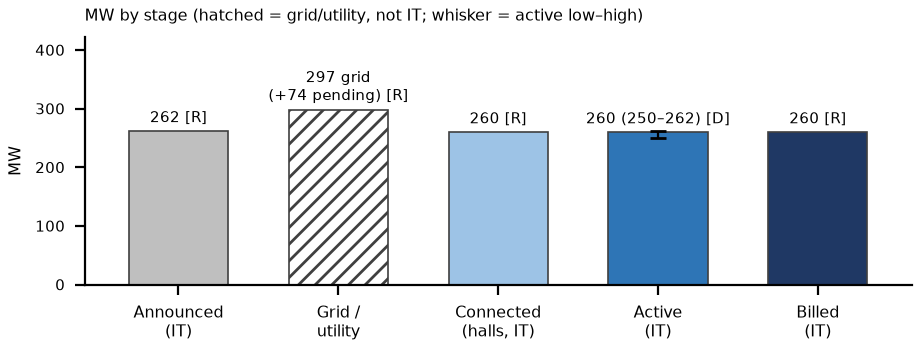

# Appendix: CoreWeave Denton, TX (Core Scientific landlord) site status, as of Thu Oct 8, 2026, ~3:15 PM ET
_Nebius Peer KPIs. Public sources only. Grade: Green (unchanged since Oct 5). Same layout and definitions as the Vineland appendix._

Definitions (team, as in capacity/vineland_site_appendix): Announced = company-stated build-out. Connected = power delivered into fully built, equipped halls (can sit idle until GPUs arrive); grid/utility MW is shown on its own row and is NOT IT MW. Active = power used by installed, operating IT. Billed = revenue-generating IT MW. Tags: R reported (company/regulator), P press/third party, D derived, E estimated, n/d not disclosed. [n] = sources.

## 1. Site facts
| Item | Fact | Tag | Src |
|---|---|---|---|
| Owner / landlord | Core Scientific (Core Scientific Denton LLC); City of Denton ground lease to 12/31/2035, extends with the PPA | R | 1 |
| Tenant / operator | CoreWeave (colocation licence; CoreWeave pays utility costs); end customer n/d | R | 1 |
| Location / build | 8171 Jim Christal Rd, Denton TX; ~64 ac (78.85 ac after 2024 amendment); 8 bldgs A–H, 370,284 sf; ex-bitcoin campus, HPC conversion from Q3'24; GC T5 | R | 1, 7 |

## 2. MW: announced / connected / active / billed
| Stage | MW | Basis | Tag | Src |
|---|---|---|---|---|
| Announced | 262 IT / 394 grid | full build | R | 1, 2 |
| Connected (grid / utility) | 297 energized + 74 to energize | grid, not IT | R | 3 |
| Connected (halls) | ~260 | IT; 'substantially complete' | R | 5 |
| Active | ~260 (250–262) | IT; landlord says billing | D | 5 |
| Billed | ~260 | IT; CORZ billing CoreWeave, mid-Jul | R | 5 |
| YE26 billed L / B / H | 260 / 262 / 262 | IT | E | 6 |

Billed = landlord (CORZ) billing CoreWeave; CoreWeave's own billed MW at Denton n/d. Apr 21 8-K: Bldgs D–G ~132 MW billing, rest H2'26; Jul 28 deck: ~260 MW billing of >430 MW CORZ total [1, 5]. City (Sep 22) cites 391 MW electrical capacity [8].

## 3. Power and interconnection
| Item | Status | Tag | Src |
|---|---|---|---|
| Utility / ISO | Denton Municipal Electric PPA (~394 MW potential); ERCOT | R | 2, 7 |
| ERCOT status | 297 MW 'Base Load, Pathway (a)' (energized before 3/25/2022), outside Batch Zero; +74 MW validated in ERCOT 2025 RTP, outside Batch Zero | R | 3 |
| Substations / grid | 2 new on-site substations (CORZ-funded); DME/ERCOT upgrades by 2029; city: transmission near limits | R | 7, 8 |
| PPA headroom | DME (Sep 22): CORZ not yet at its PPA MW cap; no extra power requested; asked to lease more DME land 3–4 months earlier | R | 8 |
| On-site generation | Emergency / standby gensets only (PBR); campus is grid-powered | R | 9 |

## 4. Permits (TCEQ / state / local)
| Permit | Status / dates | Tag | Src |
|---|---|---|---|
| TCEQ PBR 179143 | §106.511 standby engines/turbines, 'Core Scientific Data Center Site 1 And 2 Denton', ack 2025-02-11 (RN111355798) | R | 9 |
| Major NSR / PSD / Title V | None found: no Denton DC entry on TCEQ Title V list (data 10/8) or NSR list (run 10/8) | R absence | 10 |
| City | PPA + land-lease amendments approved 2024-11-19; no city tax incentives requested | R | 7 |

## 5. Imagery, construction evidence and contract economics
| Check | Finding | Tag | Src |
|---|---|---|---|
| Sentinel-2 Oct 5 v Sep 15 | Fully roofed campus, no new pads; white-roof 17.6 v 18.7 ha (same metric; illumination noise). Not load evidence | D; read E | 11 |
| 2023 → 2026 imagery | White-roof ~9.8 → ~18.7 ha; south pad from Oct-25; thermal confounded by mining-era load | D; E | 6 |
| Contract economics | CORZ–CoreWeave ~590 MW, '$10B+' over the term → ~$1.4M per MW-yr colocation (D, ~12 yrs). Facility rent, not compute $/MW. Denton $ n/d | R; D | 5 |

**What would change our view:** (1) CORZ Q3 results ~Oct 23 [E] and CoreWeave Q3 ~early Nov [E]: confirm 262 MW complete/billing and a date for the +74 MW (bull: expansion past 262) [5, 12]. (2) Denton moratorium: 2nd hearing Oct 27, vote as early as Dec 1. City attorney: it 'does not necessarily stop an existing project', but CORZ's extra-land request could be caught (bear for expansion only) [8]. (3) ERCOT large-load audit reports Dec 10, PUCT Dec 17: reclassifying the +74 MW is the bear [3, 13]. Biggest risk: low for the 262 MW in service; only expansion optionality is exposed.

**What changed since Oct 5:** Since Oct 5: Denton moratorium process (Oct 27 hearing; vote ≥ Dec 1) and CORZ land request added; Oct 5 Sentinel-2 scene shows no change; MW unchanged.

## Sources
- [1] CORZ 8-K Ex.99.2 (2026-04-21) https://www.sec.gov/Archives/edgar/data/1839341/000119312526165121/d149019dex992.htm (acc. Oct 8)
- [2] CORZ/CoreWeave PR (2025-02-26) https://www.businesswire.com/news/home/20250226866161/en/Core-Scientific-and-CoreWeave-Announce-%241.2-Billion-Expansion-at-Denton-TX-Site (acc. Oct 5)
- [3] CORZ 8-K (2026-09-10, ERCOT status) https://investors.corescientific.com/sec-filings/all-sec-filings/content/0001839341-26-000023/0001839341-26-000023.pdf (acc. Oct 8)
- [5] CORZ Q2'26 deck (2026-07-28) https://www.sec.gov/Archives/edgar/data/1839341/000183934126000013/q2fy26earningsdeck728am.htm (acc. Oct 5; sites/docs/corz_q226_deck.txt)
- [6] Team: peers/sites/site_verification.md §1; sites.xlsx; strips/denton_tx_strip.png
- [7] City of Denton (2024-11-20) https://www.cityofdenton.com/CivicAlerts.aspx?AID=922 (acc. Oct 5)
- [8] Community Impact (2026-09-24) https://communityimpact.com/denton/government/denton-officials-weigh-data-center-moratorium-during-first-public-hearing/ (acc. Oct 8)
- [9] TCEQ PBR 179143 https://records.tceq.texas.gov/cs/idcplg?IdcService=TCEQ_EXTERNAL_SEARCH_GET_FILE&Rendition=Web&dID=8656717 ; sites/docs/denton_tceq_pbr_179143.pdf (acc. Oct 5)
- [10] TCEQ Title V pending (data 10/8/2026) https://www.tceq.texas.gov/assets/public/permitting/air/reports/applications/titlev-pending-permits.html ; NSR pending (run 10/8/2026) https://www.tceq.texas.gov/assets/public/permitting/air/reports/applications/nsr-pending-permits.html (acc. Oct 8)
- [11] Sentinel-2 L2A S2B_14SPB_20261005 (Earth Search); sites/imagery/denton_tx/detail/denton_tx_2026-10-05_crop_oct8.png
- [12] CORZ Q3 date (third party) https://www.marketbeat.com/earnings/reports/2026-10-23-core-scientific-inc-stock/ (acc. Oct 8)
- [13] Gov. Abbott (2026-09-21) https://gov.texas.gov/news/post/governor-abbott-directs-tceq-to-halt-data-center-permits ; ERCOT audit timeline https://computelaw.blog/brief/texas-governor-pauses-environmental-permits-for-data-centers-until-state-audits-end/ (acc. Oct 8)

_Built by `peers/sites/build_site_appendices.py` (content `site_data.py`); one page landscape (docx → PDF via LibreOffice)._
