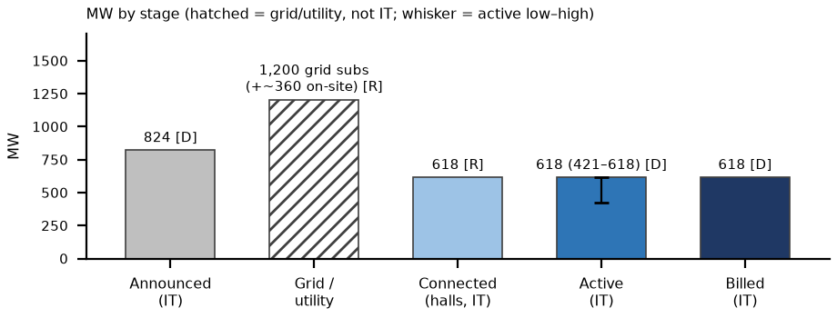

# Appendix: Crusoe Abilene, TX (Stargate; Oracle / OpenAI tenant) site status, as of Thu Oct 8, 2026, ~3:15 PM ET
_Nebius Peer KPIs. Public sources only. Grade: Green (B1–6 delivered) / Yellow (B7–8 by YE26; expansion permit frozen). Oracle's Abilene MW is counted here only, not under Oracle._

Definitions (team, as in capacity/vineland_site_appendix): Announced = company-stated build-out. Connected = power delivered into fully built, equipped halls (can sit idle until GPUs arrive); grid/utility MW is shown on its own row and is NOT IT MW. Active = power used by installed, operating IT. Billed = revenue-generating IT MW. Tags: R reported (company/regulator), P press/third party, D derived, E estimated, n/d not disclosed. [n] = sources.

## 1. Site facts
| Item | Fact | Tag | Src |
|---|---|---|---|
| Land / developer | Lancium (Clean Campus land, substations); Crusoe developer/builder via financing JV (Blue Owl per team files) | R; P | 1, 14 |
| Tenant / end user | Oracle (OCI) leases all 8 buildings; OpenAI is the end user (Stargate); NVIDIA GB200 NVL72 | R | 1, 2 |
| Location | Longhorn Data Center, 615 FM 2404, Abilene, Taylor County (32.508, −99.777). Adjacent Crusoe–Microsoft 900 MW campus (2 × 336 IT, 2027+) excluded | R | 7, 14 |

## 2. MW: announced / connected / active / billed
| Stage | MW | Basis | Tag | Src |
|---|---|---|---|---|
| Announced | 1.2 GW gross / 8 bldgs; ~824 IT implied | 618 ÷ 0.75; Epoch ~843 IT | R; D; P | 1, 2, 3 |
| Connected (grid / utility) | 200 (138 kV) + 1,000 (345 kV) subs; ~360 on-site gas | grid / on-site, not IT | R | 4, 5 |
| Connected (halls) | 618 delivered (6 of 8 bldgs, 75%) | basis unstated; read as IT | R; basis E | 2 |
| Active | 618 (421–618) | IT; delivered + accepted (R) read as active; low = Epoch to Jul-27 | D on R; P | 2, 3 |
| Billed | ~618 (Oracle → OpenAI) | acceptance 'only 24 hours' | D | 2 |
| YE26 billed L / B / H | 618 / 721 / 824 | IT; B7–8 ≈ 103 each | E | 2, 3 |

CHANGED vs Oct 5 (active 200 / 421 / 421): Oracle's Sep 10 call (FQ1 FY27) says 6 of 8 buildings, 618 MW and 75% of capacity are delivered to the customer, with 131k GPUs delivered there in the quarter [2]. The JV's lease billing to Oracle is n/d.

## 3. Power and interconnection
| Item | Status | Tag | Src |
|---|---|---|---|
| Utility / ISO | ERCOT; AEP interconnection via Lancium 138 kV and 345 kV substations | R | 4 |
| 345 kV substation | 1st transformer 2025-12-19; all 5 MPTs by 2026-03-10 (3 temporary); permanent swaps targeted Oct 2026 | R | 4 |
| On-site generation | Std Permit 177263: 5 Solar Titan 350 + 5 GE LM2500 ≈ 360.5 MW, 8,760 h/yr, on-site use only; ~62 diesel gensets (PBR, reported 177262). Crusoe: turbines are backup | R; P | 5, 6 |

## 4. Permits (TCEQ / state / local)
| Permit | Status / dates | Tag | Src |
|---|---|---|---|
| 177263 (issued) | Abilene DC 1 LLC dba Crusoe; modification reviewed Jan 2025 | R | 5 |
| 182126 / PSDTX1688 / GHGPSDTX263 | Crusoe Energy Systems, Longhorn DC (RN112029061): filed 2025-11-07; NORI 11-19; NAPD + draft 2026-08-05; TCEQ list: 'Technically Complete' (data 8/28, run 10/8). NOT issued | R | 7, 8 |
| Scope of 182126 | Bldgs 9–10 / added on-site generation: 39 simple-cycle turbines, up to ~1,330 MW (EIP) vs 41 turbines + 18 gensets (Tribune) | R; P | 7, 9, 6 |
| Sep 21 state pause | No TCEQ data-center permits until ERCOT audit; TCEQ compliance report due Oct 19; ERCOT audit reports Dec 10, PUCT Dec 17 | R; P | 10, 11 |
| Incentives | City 85% / Taylor County 80% 10-yr abatements, one agreement per building | P | 12 |

## 5. Imagery, construction evidence and contract economics
| Check | Finding | Tag | Src |
|---|---|---|---|
| Sentinel-2 Oct 5 v Sep 15 | All 8 halls roofed with chiller yards; large new works on the southern (Microsoft) campus. Beige roofs read low on the white-roof metric (14.9 v 10.9 ha); energized halls not visible at 10 m | D; read E | 13 |
| Thermal | Landsat Jun–Aug anomaly +0.40 → −0.41 °C: not informative (red soil) | E | 14 |
| Contract economics | Oracle–OpenAI ~$300B / 5 yrs (WSJ; not in Oracle filings) = $13.3M per stated MW-yr, $16.0M per IT MW-yr if 4.5 GW is gross: inside the $9.7–16.7M band. Site lease n/d. JV shell + power ≈ $12.5M per gross MW | P; D | 15, 16 |

**What would change our view:** (1) TCEQ report to the Governor Oct 19: as written the pause freezes 182126 (Bldgs 9–10, ~1.3 GW gas) only; extension to modifications or turbine operation would hit B1–8 backup (bear) [10, 11]. (2) Permanent 345 kV transformer swaps 'by Oct 2026' and Oracle FQ2 FY27 (~mid-Dec, E): 8 of 8 delivered (~824) is the bull; Epoch projected 843 IT ~Nov 1 [3, 4]. (3) ERCOT audit Dec 10 / PUCT Dec 17; Legislature from Jan 2027 on incentives [11]. Biggest risk: growth past 8 buildings is frozen until the audit; the 618 MW in service is not.

**What changed since Oct 5:** Since Oct 5: active base 421 → 618 MW on Oracle's Sep 10 statement (in the Oracle pack, not previously in the site view); 182126 confirmed not issued (Technically Complete); EIP turbine count; ERCOT Dec 10/17 dates.

## Sources
- [1] Crusoe PR (2025-09-30) https://www.crusoe.ai/resources/newsroom/crusoe-announces-flagship-abilene-data-center-is-live (acc. Oct 8); 1.2 GW / 8 bldgs per Crusoe JV PR 2025-05-21 (sites.xlsx)
- [2] Oracle FQ1 FY27 call (2026-09-10; transcript 09-11) https://www.fool.com/earnings/call-transcripts/2026/09/11/oracle-orcl-q1-2027-earnings-call-transcript/ (acc. Oct 8)
- [3] Epoch AI https://epoch.ai/data/ai-data-centers/directory/openai-stargate-abilene (acc. Oct 5)
- [4] Mortenson https://www.mortenson.com/projects/abilene-data-center-development (acc. Oct 5)
- [5] TCEQ Std Permit 177263 tech review: sites/docs/abilene_tceq_177263_tech_review.pdf
- [6] Texas Tribune / Floodlight (2026-07-09) https://www.texastribune.org/2026/07/09/texas-data-centers-ai-power-plants-pollution-state-permits/ (acc. Oct 5)
- [7] TCEQ 182126 plain-language summary https://www.tceq.texas.gov/downloads/permitting/air/bilingual/pending-permit-notices/182126-pls-english.pdf ; sites/docs/abilene_tceq_182126_napd.pdf, _nori.pdf (acc. Oct 8)
- [8] TCEQ NSR pending (run 10/8/2026) https://www.tceq.texas.gov/assets/public/permitting/air/reports/applications/nsr-pending-permits.html (acc. Oct 8)
- [9] EIP Oil & Gas Watch https://oilandgaswatch.org/alert/fc44e871-e7e9-4d4e-af22-bce4133e16d3 (acc. Oct 8)
- [10] Gov. Abbott (2026-09-21) https://gov.texas.gov/news/post/governor-abbott-directs-tceq-to-halt-data-center-permits (acc. Oct 8)
- [11] Texas Lawbook https://texaslawbook.net/abbott-orders-statewide-pause-on-texas-data-center-permits/ ; https://computelaw.blog/brief/texas-governor-pauses-environmental-permits-for-data-centers-until-state-audits-end/ (acc. Oct 8)
- [12] DCOA (2025-05-01) https://developabilene.com/2025/05/01/project-radiance-powering-the-future-of-ai-in-abilene-texas/ (acc. Oct 5)
- [13] Sentinel-2 L2A S2A_14SMA_20261005 (Earth Search); sites/imagery/abilene_tx/detail/abilene_tx_2026-10-05_crop_oct8.png
- [14] Team: peers/sites/site_verification.md §4; sites.xlsx; strips/abilene_tx_strip.png; thermal/abilene_tx_landsat_st.csv; peers/oracle/oracle_kpis.xlsx Inputs Q40 (Blue Owl)
- [15] peers/comparison.xlsx Contracts_$MWyr O2 (WSJ) / NEW8
- [16] peers/private/private_peers.md (Crusoe K14, D)

_Built by `peers/sites/build_site_appendices.py` (content `site_data.py`); one page landscape (docx → PDF via LibreOffice)._
