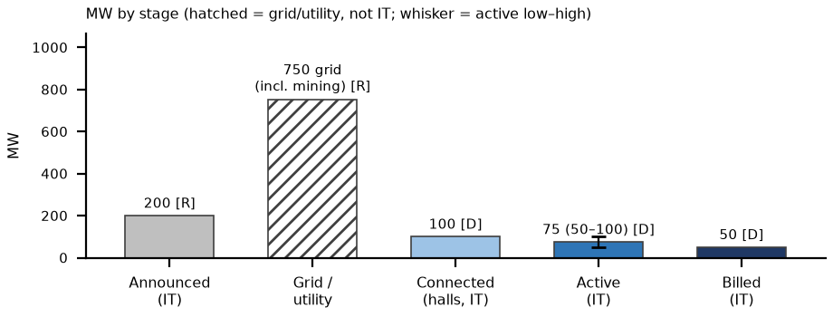

# Appendix: IREN Childress, TX (Microsoft Horizons) site status, as of Thu Oct 8, 2026, ~3:15 PM ET
_Nebius Peer KPIs. Public sources only. Grade: Green (H1–2) / Yellow (H3–4 by Q4'26), unchanged since Oct 5. Site grid MW includes legacy bitcoin load._

Definitions (team, as in capacity/vineland_site_appendix): Announced = company-stated build-out. Connected = power delivered into fully built, equipped halls (can sit idle until GPUs arrive); grid/utility MW is shown on its own row and is NOT IT MW. Active = power used by installed, operating IT. Billed = revenue-generating IT MW. Tags: R reported (company/regulator), P press/third party, D derived, E estimated, n/d not disclosed. [n] = sources.

## 1. Site facts
| Item | Fact | Tag | Src |
|---|---|---|---|
| Owner / operator | IREN (SPV Ie US Development Holdings 3 Inc.); IREN-owned 576 ac | R | 1, 2 |
| Tenants | Microsoft: Horizons 1–4, 4 × 50 MW IT liquid-cooled GB300 NVL72, $9.7B / 5 yrs. NVIDIA: $3.4B in ~60 MW of existing halls from early 2027 | R | 3, 4 |
| Location / legacy | 620 FM 1033, Childress County TX; Phases 1–5 = 650 MW bitcoin 'operating data centers' (Aug-25), winding down | R | 2, 5 |

## 2. MW: announced / connected / active / billed
| Stage | MW | Basis | Tag | Src |
|---|---|---|---|---|
| Announced | 750 grid; 200 IT (H1–4) + ~60 (NVIDIA) | H5–6 (2027) MW n/d | R | 3, 4, 6 |
| Connected (grid / utility) | 750 | grid incl. mining load | R | 6 |
| Connected (halls) | ~100 (H1 + H2 commissioning) | IT | D | 3 |
| Active | 75 (50–100) | IT, AI only | D | 3, 7 |
| Billed | 50 (H1 accepted Aug 13) | IT; H2 n/d until acceptance | D on R | 7 |
| YE26 billed L / B / H | 100 / 150 / 200 | IT | E | 8 |

Site grid load ≠ AI IT: the 750 MW interconnection still carries mining load. H2 'commissioning underway' and H3–4 'late-stage construction, targeting delivery in Q4 2026' (Aug 27) [3]; no H2 acceptance found as of Oct 8.

## 3. Power and interconnection
| Item | Status | Tag | Src |
|---|---|---|---|
| Utility / ISO | AEP Texas / ERCOT; IREN-owned substations, dual diverse connection | R | 2 |
| ERCOT status | Existing energized load (raised 600 → 750 MW on 2024-07-24 after ERCOT study); not a Batch Zero new-interconnect case; 2nd bulk transformer energized for H1–2 | R | 5, 6 |
| Regional grid | ERCOT-endorsed AEP Childress Area Transmission Improvement (Tier 2, ~$77.3M, ISD Nov 2031, CCN needed): area reliability, not site supply | R | 9 |
| On-site generation | None found; Title V filing implies permitted emission units (unit list n/d) | R abs.; E | 10 |

## 4. Permits (TCEQ / state / local)
| Permit | Status / dates | Tag | Src |
|---|---|---|---|
| TCEQ Title V #4951 | 'Childress Data Center', Ie US Development Holdings 3; received 2026-08-17; Administrative Complete (list data 10/8, unchanged since Oct 5) | R | 10 |
| Major NSR / PSD | None found (NSR pending list run 10/8: no IREN / Childress DC entry) | R absence | 11 |
| Sep 21 state pause | TCEQ issues no data-center permits until the ERCOT audit; Childress is on third-party lists of pending DC applications, so #4951 waits; operations continue meanwhile [E] | R; P; E | 12 |
| County | Ch. 312 abatements / Iris Reinvestment Zone (IE US entities) | R | 13 |

## 5. Imagery, construction evidence and contract economics
| Check | Finding | Tag | Src |
|---|---|---|---|
| Sentinel-2 Oct 5 v Sep 28 | Mining sheds + new west/north halls + grey SE facility; white-roof 9.0 v 12.8 ha (same metric; sun/view noise, no demolition seen). H2–H4 not separable at 10 m | D; read E | 14 |
| 2023 → 2026 imagery | White-roof 0.5 → 19–25 ha (Mar–Jul 26); thermal dominated by mining | D; E | 8 |
| Contract economics | Microsoft $9.7B / 5 yrs / 200 IT MW = $9.7M per IT MW-yr (bottom of the $9.7–16.7M comp band). NVIDIA $3.4B / 5 / ~60 = ~$11.3M (MW unlabeled). IREN: 'active discussions at ~$25M per MW (IT)', not signed | R; D | 3, 15 |

**What would change our view:** (1) Horizon 2 acceptance PR and H3–4 delivery in Q4'26: each accepted 50 MW adds billed MW; a slip past Dec 31 leaves YE26 at the 100 MW low [3, 7]. (2) IREN Q1 FY27 results ~early–mid Nov [E]: H2–H4 status and NVIDIA 60 MW ramp [3]. (3) TCEQ compliance report Oct 19; ERCOT audit Dec 10 / PUCT Dec 17: #4951 stays unissued under the pause; bear only if the state moves against operating sites [12]. Biggest trigger: H2–H4 acceptance timing (YE26 billed 100 / 150 / 200).

**What changed since Oct 5:** Since Oct 5: no IREN 8-K; #4951 still Administrative Complete (TCEQ data 10/8) and now explicitly inside the Sep 21 permit pause; H2 still not accepted; Oct 5 Sentinel-2 adds nothing.

## Sources
- [1] Texas Comptroller data-center list (LD926028) https://comptroller.texas.gov/taxes/data-centers/data-center-lists.php (acc. Oct 5)
- [2] IREN Childress page https://iren.com/data-centers/childress (acc. Oct 5)
- [3] IREN FY26 results (2026-08-27) https://www.sec.gov/Archives/edgar/data/1878848/000187884826000051/irenreportsfy26results.htm (acc. Oct 8; sites/docs/iren_fy26.txt)
- [4] IREN Q3 FY26 (2026-05-07, NVIDIA $3.4B) via peers/iren/iren_kpis.md
- [5] IREN Aug-2025 update https://iren.gcs-web.com/static-files/ec8ec2a6-a1d1-4bb6-9cb9-bc2d436b9db9 (acc. Oct 5)
- [6] IREN PR (2024-07-24) https://www.nasdaq.com/press-release/iren-increases-childress-power-capacity-600mw-750mw-2024-07-24 (acc. Oct 5)
- [7] IREN 8-K Ex.99.1 (2026-08-13, H1 accepted) https://www.sec.gov/Archives/edgar/data/1878848/000114036126032638/ef20080141_ex99-1.htm (acc. Oct 8)
- [8] Team: peers/sites/site_verification.md §2; sites.xlsx; strips/childress_tx_strip.png
- [9] PUC Docket 55999 Item 173 https://interchange.puc.texas.gov/Documents/55999_173_1556587.PDF (acc. Oct 5)
- [10] TCEQ Title V pending (data 10/8/2026) https://www.tceq.texas.gov/assets/public/permitting/air/reports/applications/titlev-pending-permits.html (acc. Oct 8)
- [11] TCEQ NSR pending (run 10/8/2026) https://www.tceq.texas.gov/assets/public/permitting/air/reports/applications/nsr-pending-permits.html (acc. Oct 8)
- [12] Gov. Abbott (2026-09-21) https://gov.texas.gov/news/post/governor-abbott-directs-tceq-to-halt-data-center-permits ; https://computelaw.blog/brief/texas-governor-pauses-environmental-permits-for-data-centers-until-state-audits-end/ (acc. Oct 8)
- [13] Childress County tax abatements https://www.childresstx.us/pages/tax-abatements ; sites/docs/childress_county_abatement_notice_2023-08.pdf (acc. Oct 5)
- [14] Sentinel-2 L2A S2A_14SLD_20261005 (Earth Search); sites/imagery/childress_tx/detail/childress_tx_2026-10-05_crop_oct8.png
- [15] peers/comparison.xlsx Contracts_$MWyr rows P1 / NEW1 (comp band $9.7–16.7M)

_Built by `peers/sites/build_site_appendices.py` (content `site_data.py`); one page landscape (docx → PDF via LibreOffice)._
