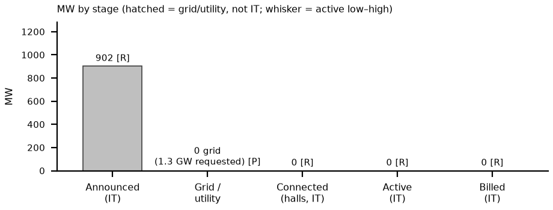

# Appendix: Oracle (OCI) Port Washington, WI (Vantage 'Lighthouse'; Stargate) site status, as of Thu Oct 8, 2026, ~3:15 PM ET
_Why this site: Oracle's largest live AI site is Abilene, the SAME campus as Crusoe Abilene (Oracle is the tenant), so it is counted once, under Crusoe. Port Washington is Oracle's separable key site. Shackelford County TX (Oracle: 'our next gigawatt scale campus', not delivered in FQ1) not built: thinner public record (gap). Grade: Yellow/Red vs end-2027 handover (unchanged)._

Definitions (team, as in capacity/vineland_site_appendix): Announced = company-stated build-out. Connected = power delivered into fully built, equipped halls (can sit idle until GPUs arrive); grid/utility MW is shown on its own row and is NOT IT MW. Active = power used by installed, operating IT. Billed = revenue-generating IT MW. Tags: R reported (company/regulator), P press/third party, D derived, E estimated, n/d not disclosed. [n] = sources.

## 1. Site facts
| Item | Fact | Tag | Src |
|---|---|---|---|
| Developer / owner | Vantage Data Centers (Wisco Acquisition Co.); $15B; 4 bldgs, ~2.5M sf | R; P | 1, 2 |
| Tenant / end user | Oracle (OCI) for OpenAI (Stargate); turnover in phases from end-2027 | P | 2 |
| Location | North Port Washington, Ozaukee County WI; 672 ac (later phases up to 3.5 GW, press) | P | 1, 3 |

## 2. MW: announced / connected / active / billed
| Stage | MW | Basis | Tag | Src |
|---|---|---|---|---|
| Announced | ~902 IT / 1.3 GW electrical | Vantage IT v utility total | R; P | 1, 4 |
| Connected (grid / utility) | 0 | ~310 requested for 2027; 438 peak 2027 | P | 4 |
| Connected (halls) | 0 | 20–25% complete; 2 of 4 halls enclosed | R; P | 2, 5 |
| Active | 0 | IT | R | 6 |
| Billed | 0 | IT | R | 6 |
| YE26 / YE27 L / B / H | 0 / 0 / 0; YE27 0 / ~310 / 438 | YE27 = grid MW | E | 4, 5 |

Oracle (Sep 10): 'neither Shackleford nor New Mexico or Wisconsin or Michigan were delivered in Q1' [6]. Utility filings (via press) show Vantage asked ATC for ~310 MW in 2027 and 1.3 GW from 2028 [4].

## 3. Power and interconnection
| Item | Status | Tag | Src |
|---|---|---|---|
| Utility | We Energies (very-large-customer tariff; PSC 6630-TE-113 collateral rules; Oracle dropped its court challenge Aug 17) | R; P | 3, 7 |
| Transmission | ATC Ozaukee County project $1.39–1.67B, new Decker substation; construction Dec 2026 – Dec 2027 | R | 8 |
| PSC status | Completeness revoked Aug 2026; case closed Sep 10; ATC refiled (Sep 14 per Wisconsin Watch, Sep 18 per TechRadar); completeness decision expected ~Oct 19 | P | 4, 5, 9 |
| Aterio timing | Partial power Oct 2027 earliest / Dec 2027 base / Jun 2028 extended; full 1.3 GW Aug 2028 / Oct 2028 / Apr 2029 | P | 5 |
| On-site generation | Up to 45 emergency diesel engines, 87 MW: backup only | R | 10 |

## 4. Permits (TCEQ / state / local)
| Permit | Status / dates | Tag | Src |
|---|---|---|---|
| WDNR air | Construction 25-MIN-094 + operation 24618528A-F01, final 2026-06-12 | R | 10 |
| PSC (ATC line) | Refiled; completeness pending (~Oct 19) | R; P | 8, 9 |
| City | TIF $458.6M | P | 1 |

## 5. Imagery, construction evidence and contract economics
| Check | Finding | Tag | Src |
|---|---|---|---|
| Sentinel-2 Oct 6 v Sep 11 | More roofs closed: white-roof 28.9 v 22.9 ha (+6 ha, same metric); still a construction site; no energized power plant visible at 10 m | D; read E | 11 |
| Press photos | Ozaukee Press aerial 2026-09-21: first 555k sf building enclosed; Sep 18 tour; 2,800–3,000 workers/day | P | 2 |
| Contract economics | Oracle–OpenAI ~$300B (WSJ) program-level, $13.3–16.0M per MW-yr; site lease n/d | P; D | 12 |

**What would change our view:** (1) PSC completeness decision ~Oct 19 (with ATC's MISO voltage-device filing): a clean finding keeps Aterio's base (partial power ~Dec 2027); another rejection moves to the extended case (Jun 2028) [5]. (2) Oracle FQ2 FY27 (~mid-Dec, E): any change to 'H2 2027' Wisconsin delivery [6]. (3) Watch for a temporary / bypass supply for the ~310 MW 2027 request; Vantage says portions go live while the rest is built [2, 4]. Biggest risk: grid, not construction: halls can be ready before power (connected 0 into late 2027).

**What changed since Oct 5:** Since Oct 5: PSC completeness ~Oct 19 trigger, ATC refile-date conflict and the ~310 MW 2027 request added; Oracle confirms no Wisconsin delivery in FQ1; Oct 6 Sentinel-2 +6 ha roof.

## Sources
- [1] Ozaukee Press (2025-10-22) https://www.ozaukeepress.com/content/openai-oracle-run-stargate-port-data-center (acc. Oct 5)
- [2] Ozaukee Press (2026-09-23) https://www.ozaukeepress.com/content/data-center-size-%E2%80%98-insane%E2%80%99 (acc. Oct 8)
- [3] Data Center Census https://datacentercensus.com/dc/port-washington-lighthouse-wi (acc. Oct 8)
- [4] TechRadar (2026-10-04) https://www.techradar.com/pro/a-meaningful-risk-oracles-massive-1-3-gw-wisconsin-ai-campus-faces-severe-power-delays-as-grid-review-restarts-pushing-customer-delivery-past-2027 (acc. Oct 8)
- [5] Aterio (BusinessWire 2026-09-30) https://www.streetinsider.com/Business+Wire/Aterio+Flags+Delay+Risk+for+Oracle%E2%80%99s+1.3+GW+Wisconsin+Data+Center/27125698.html ; https://constructionreviewonline.com/project-lighthouse-delays-threaten-oracles-2027-wisconsin-data-center-launch/ (acc. Oct 8)
- [6] Oracle FQ1 FY27 call (2026-09-10) https://www.fool.com/earnings/call-transcripts/2026/09/11/oracle-orcl-q1-2027-earnings-call-transcript/ (acc. Oct 8)
- [7] PSC doc 593736 https://apps.psc.wi.gov/ERF/ERFview/viewdoc.aspx?docid=593736 (acc. Oct 5)
- [8] PSC doc 597276 https://apps.psc.wi.gov/ERF/ERFview/viewdoc.aspx?docid=597276 (acc. Oct 5)
- [9] Wisconsin Watch https://wisconsinwatch.org/2026/09/wisconsin-port-washington-data-center-atc-restarts-push-grid-upgrades-transmission-utility/ (acc. Oct 5)
- [10] WDNR 25-MIN-094 final https://www.wpr.org/wp-content/uploads/2026/07/dnr.state_.wi_.us_Apps_AM_WARP_Documents_PROD_Final_63297.pdf ; sites/docs/wi_dnr_vantage_25-MIN-094_final.pdf (acc. Oct 5)
- [11] Sentinel-2 L2A S2B_16TDP_20261006 (Earth Search); sites/imagery/portwash_wi/detail/portwash_wi_2026-10-06_crop_oct8.png
- [12] peers/comparison.xlsx Contracts_$MWyr O2; team peers/sites/site_verification.md §6; sites.xlsx

_Built by `peers/sites/build_site_appendices.py` (content `site_data.py`); one page landscape (docx → PDF via LibreOffice)._
